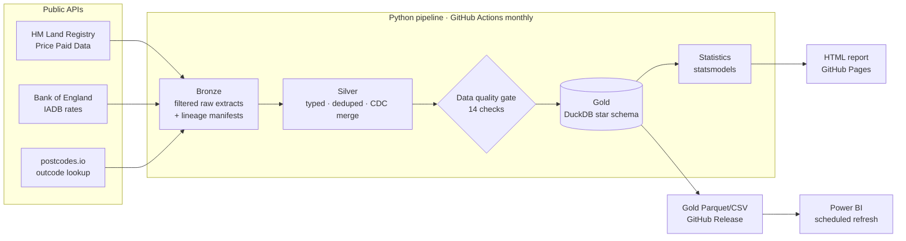
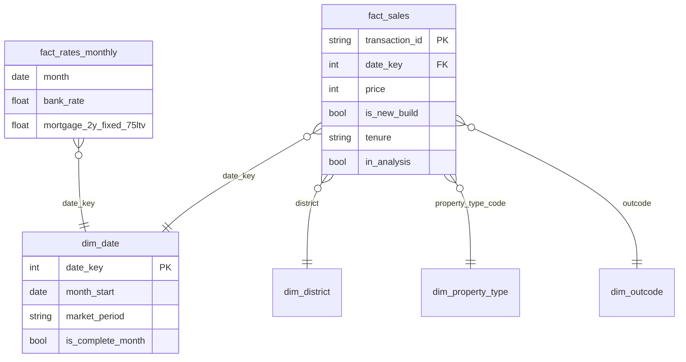

# North West Housing & Interest Rates: automated analytics pipeline

[](https://github.com/raniabdj/nw-housing-analytics/actions/workflows/ci.yml)
[](https://github.com/raniabdj/nw-housing-analytics/actions/workflows/monthly-refresh.yml)

**Live report:** https://raniabdj.github.io/nw-housing-analytics/ · **Power BI:** [`powerbi/`](powerbi/)

> **Business question:** *How did the 2021–2023 interest-rate cycle change the housing market in North West England, and Liverpool in particular?
> Did it hit prices, the number of sales, or what buyers pay each month?*

The project is an end-to-end, scheduled data product built on three public APIs. Every month it:

1. **Extracts** every registered home sale in the North West from **HM Land Registry**, interest rates from the **Bank of England**, and outcode coordinates from **postcodes.io**
2. **Transforms** the data through bronze → silver layers, applying Land Registry's monthly corrections and deletions (change data capture)
3. **Gates** it with 14 data quality checks; a blocking failure stops the run before bad data reaches reporting
4. **Loads** a **DuckDB star schema** built with SQL models
5. **Analyses** it statistically: a mix-adjusted (hedonic) price index and a lagged regression of sales on interest rates
6. **Publishes** an auto-written HTML report to GitHub Pages and refreshed tables that a **Power BI** dashboard reads directly

<!-- After the first live run, replace this with a screenshot:  -->

---

## Key findings

The live report writes its findings from the latest data on every run. It covers:

- **Volume vs price:** how far sales have fallen against 2019, the last normal pre-pandemic year, while prices kept rising
- **Rate sensitivity:** the % change in monthly sales for each +1 percentage point of Bank Rate, with a 95% CI and the time lag at which the effect peaks
- **Affordability:** the monthly repayment on a median-priced home in 2021 compared with the last year
- **Local view:** Liverpool against the North West, and which districts and property types recovered least
- **Mix effects:** whether the raw median price misleads, compared with a mix-adjusted index

<!-- Paste your headline numbers here after the first run, e.g.
- Sales across the North West are **X% below 2019** while the median price is **+Y%**
- Each +1pp of Bank Rate is associated with **Z% fewer sales ~N months later** (95% CI …)
-->

## Architecture



| Layer | What happens | Where |
|---|---|---|
| **Extract** | National CSVs (~150 MB/year) are streamed and filtered to 12 NW counties in chunks; the BoE CSV API and postcodes.io are called with retries, exponential back-off and a cache | `src/nwhousing/extract/` |
| **Bronze** | Region-filtered raw rows as Parquet, plus a JSON manifest per file (URL, SHA-256, rows read and kept, timestamp) | `data/bronze/` |
| **Silver** | Typing, code mapping, postcode parsing, de-duplication, outlier and category flags; **A/C/D change records merged by transaction ID** | `src/nwhousing/transform/` |
| **Quality** | Uniqueness, nulls, ranges, valid codes, region scope, missing months, completeness; `error` blocks the run, `warn` is reported | `src/nwhousing/quality.py` |
| **Gold** | SQL models: `dim_date`, `dim_district`, `dim_outcode`, `dim_property_type`, `dim_market_period`, `fact_sales`, `fact_rates_monthly`, plus marts | `src/nwhousing/sql/` |
| **Analysis** | Hedonic price index, rate-sensitivity regression, headline metrics | `src/nwhousing/analysis.py` |
| **Serve** | HTML report (Plotly, light/dark), gold Parquet/CSV for Power BI | `site/`, `data/gold/` |

## Data model



## Methods

**Analysis population.** Standard-price residential sales (PPD category A), excluding the "Other" property type and prices
outside £10k–£5m. Registrations lag completions by several months, so the latest 6 months (configurable) are flagged as provisional
(`is_complete_month = false`) and excluded from the statistics.

**Mix-adjusted price index.** A raw median moves when the *mix* of homes sold changes. The pipeline fits
`log(price) ~ month + district + property type + new build + tenure` and turns the month effects into an index (2019 = 100).
The model is fitted on cell means (month × district × type × build × tenure) weighted by sales count rather than on every individual sale. This gives
**identical coefficients**, and the standard errors are rescaled with the within-cell variance so they match the full model.

**Rate sensitivity.** `log(monthly sales) ~ Bank Rate(t − L) + month-of-year + trend + lockdown + stamp-duty holiday + deadline months`,
for lags L = 0…9. The lag is chosen by AIC, with Newey-West (HAC) standard errors because monthly series are autocorrelated.
This measures **association, not causation**: rates moved alongside inflation, energy prices and confidence.

**Affordability.** Monthly repayment = median price × 75% loan, 25-year repayment mortgage, at the Bank of England's
quoted 2-year fixed rate (75% LTV).

## Scheduling and incremental loads

`.github/workflows/monthly-refresh.yml` runs on the 3rd of each month, after Land Registry's release on the 20th working day:

| Mode | When | What |
|---|---|---|
| `backfill` | first run, no saved state | download every yearly file from 2018 |
| `incremental` | normal monthly run | apply the monthly change file (A = add, C = correct, D = delete) |
| `refresh` | last success > 40 days ago, or change file unavailable | re-pull the two latest yearly files (self-healing) |

Pipeline state (silver table, outcode cache, run history) is saved as a GitHub Release asset between runs, so a monthly run
downloads a few MB rather than ~1 GB. Gold tables are published to the `data-latest` release, which the Power BI report reads
over HTTPS, so the dashboard refreshes with no gateway. Failed scheduled runs email the repository owner.

## Run it

```bash
git clone https://github.com/raniabdj/nw-housing-analytics.git
cd nw-housing-analytics
python -m venv .venv && source .venv/bin/activate     # Windows: .venv\Scripts\activate
pip install -e ".[dev]"

python -m nwhousing run --demo      # 1 minute, offline, synthetic data → site/index_demo.html
python -m nwhousing run             # live APIs (first run backfills, ~10 min) → site/index.html
pytest                              # unit + end-to-end tests (offline)
```

Useful options: `--mode backfill|incremental|refresh`, `--data-dir`, `-v`. All settings (region, counties, start year,
focus district, mortgage assumptions, quality thresholds) are in [`config/pipeline.yaml`](config/pipeline.yaml).
To analyse a different region, change the county list.

To schedule locally instead of on GitHub, use cron (`0 6 3 * * cd /path && .venv/bin/python -m nwhousing run`) or Windows Task Scheduler.

## Testing

- **Unit tests:** cleaning and typing, CDC merge (add/change/delete, idempotency), chunked region filter, BoE parsing, postcode cache (mocked HTTP), each blocking quality rule
- **End-to-end test:** the full pipeline runs on synthetic data in the real source formats, checking star-schema referential integrity, a second incremental run, and report generation
- CI runs on Python 3.11 and 3.12 and never calls the live APIs

## Project structure

```
config/          pipeline.yaml, market periods & policy events (seed data)
src/nwhousing/
  extract/       land_registry.py · boe.py · postcodes.py
  transform/     sales.py (cleaning + CDC) · rates.py
  sql/           01_staging → 02_dimensions → 03_facts → 04_marts
  quality.py     data quality gate
  warehouse.py   DuckDB build + gold export
  analysis.py    hedonic index · rate sensitivity · headlines
  report.py      HTML report (templates/report.html.j2)
  pipeline.py    orchestration & run modes
  demo.py        synthetic data generator (tests & offline demo)
powerbi/         Power Query, DAX measures, theme, build guide
tests/           pytest suite
.github/         CI + monthly refresh workflows
```

## Design decisions

- **DuckDB over a hosted warehouse:** zero cost, runs inside CI, and the SQL models port to Snowflake or Fabric with minor syntax changes
- **Filter at extract time:** the national files are roughly 9× larger than the region, so streaming and filtering keeps memory flat and bronze small
- **Quality gate before load:** bad data fails loudly instead of quietly reaching a dashboard
- **Provisional months flagged, not hidden:** they stay visible in charts, styled differently, and are excluded from statistics
- **Two charts, not a dual axis:** sales and rates share a time axis in separate panels, so no correlation is implied by scaling

## Limitations

- Price Paid Data excludes some transactions (e.g. right-to-buy, some transfers) and has no floor area, so price per m² is not available
- The rate model is a single-region time series, so the effect estimate is an association
- Mortgage rates are national quoted rates, not what individual buyers paid

## Data sources and licence

- Contains HM Land Registry data © Crown copyright and database right. Licensed under the [Open Government Licence v3.0](https://www.nationalarchives.gov.uk/doc/open-government-licence/version/3/).
- Bank of England Database: Official Bank Rate (`IUDBEDR`), quoted 2-year fixed mortgage rate, 75% LTV (`IUMBV34`).
- [postcodes.io](https://postcodes.io): ONS and Ordnance Survey open data.

Code: MIT. Built by **Rania Boudjemadi**, [github.com/raniabdj](https://github.com/raniabdj).
